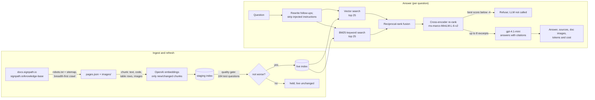

# SignPath Documentation RAG Assistant

A chat assistant that answers questions about [SignPath](https://about.signpath.io/) using only the public
[SignPath documentation](https://docs.signpath.io/) and [knowledge base](https://signpath.io/knowledge-base).
It crawls both sites, indexes the text, code examples, tables and images in a local Chroma vector database, and
answers with hybrid retrieval (vector + BM25 keyword search, fused and re-ranked by a cross-encoder) and an OpenAI
model that is told to answer from the retrieved excerpts alone and to cite them. If the docs don't cover a
question, it refuses instead of guessing.

This folder is self-contained: copy it anywhere, add an OpenAI API key, and run it natively or in Docker.

- [Production readiness](#production-readiness)
- [Contents](#contents)
- [Quick start](#quick-start)
- [How it works](#how-it-works)
- [Requirements: hardware, software, network](#requirements-hardware-software-network)
- [Tokens and secrets](#tokens-and-secrets)
- [Configuration](#configuration)
- [Access and exposure](#access-and-exposure)
- [Cost and usage tracking](#cost-and-usage-tracking)
- [Deployment: native](#deployment-native)
- [Deployment: Docker](#deployment-docker)
- [Keeping the data fresh](#keeping-the-data-fresh)
- [Quality: evaluation and release criteria](#quality-evaluation-and-release-criteria)
- [Operations and monitoring](#operations-and-monitoring)
- [Troubleshooting](#troubleshooting)
- [Debugging](#debugging)
- [Backup and disaster recovery](#backup-and-disaster-recovery)
- [Go-live checklist](#go-live-checklist)
- [Moving from the old week5 location](#moving-from-the-old-week5-location)

---

## Production readiness

What is in place in `Signpath_RAG.py` (the program the Docker image runs):

| Area | What it does |
| --- | --- |
| Safe data refresh | A refresh that changes content is built in a **staging** index next to the live one, scored with 184 test questions (the **quality gate**), and swapped in only if it is not worse. Otherwise it is **held** and the live index is untouched. The replaced index is kept for **`--rollback`**. Interrupted swaps are repaired on start. Only one refresh runs at a time. |
| Answer quality | `--eval-answers` answers every test question and has a stronger model (`gpt-4.1`) grade it against the excerpts: grounded, answers the question, code copied exactly, refuses when it should, resists prompt injection. Pass criteria give an exit code for CI. |
| Prompt-injection defence | Four layers: messages that look like instructions are reduced to their documentation question before search; the question is passed as delimited data; the system prompt tells the model to ignore embedded instructions; an answer that repeats the system prompt is withheld. |
| Abuse and spend limits | Per-client rate limit (10/min), daily cap for everyone (2000/day), max question length, 4 questions answered at a time (the rest queue), OpenAI timeouts and retries. |
| Observability | `/healthz` (ok/degraded with reasons, index freshness, quality scores, today's questions and spend), a JSON-lines question log with retrieval, answer, tokens, cost and 👍/👎 feedback, and `--feedback-report`. |
| Cost visibility | Every answer shows its tokens, estimated cost and latency, and the costs are summed per day. |
| Errors | Users see a generic message with a reference id; details and tracebacks go to the log. |
| Container | Non-root, read-only root filesystem, no Linux capabilities, `no-new-privileges`, memory/CPU/PID limits, rotated logs, published on localhost by default, health check on `/healthz`. |
| Tests | 21 offline unit tests (no network, no API key) covering chunking, ranking metrics, the quality gate, and the staging → gate → promote → rollback lifecycle. |

Measured on 2026-10-16 (index of 45 pages / 1,428 chunks):

| Measure | Tuning set (102 q.) | Held-out set (82 q., never used for tuning) |
| --- | --- | --- |
| Retrieval MRR after re-rank | 0.918 | 0.913 |
| Recall@5 (both sets) | 0.965 | |
| Answerable questions passing the answer evaluation | 96/96 | 50/53 |
| Out-of-scope + prompt-injection questions handled correctly | 34/35 (both sets) | |
| Answers that followed an injected instruction or leaked the prompt | 0 | 0 |
| Code blocks not faithful to the docs | 0 | 0 |
| Cost per question | ≈ $0.0008 average, ≈ $0.0019 max | |
| Answer latency (4 parallel) | 4.0 s average | |

Known limitations:

- **Some answerable questions are refused.** 2 of 53 held-out questions are refused by the relevance gate (an
  expired invitation; re-signing old builds after an installer layout change), and 1 by the model. A refusal is
  the safe failure, but users see "I don't have information". Watch the refused questions in `--feedback-report`.
- **The held-out set is no longer fully independent.** Its prompt-injection tests exposed two real failures, and
  the fixes were made after seeing them. Add fresh test questions from real usage (see
  [Quality](#quality-evaluation-and-release-criteria)).
- **There are no logins.** Whoever can reach the port can use it and spend OpenAI budget, within the rate limits.
  See [Access and exposure](#access-and-exposure).
- **Single instance.** Chroma runs embedded, so run one app process per data folder. For more capacity, raise
  `SIGNPATH_CONCURRENCY` and give the container more CPU. Multiple replicas would each need their own data copy.
- **Depends on OpenAI.** Without it, nothing is answered (every question needs an embedding and a completion).

## Contents

| Path | What it is |
| --- | --- |
| `Signpath_RAG.py` | **The production program.** Crawler, indexer, retrieval, Gradio UI, quality-gated auto-refresh, evaluations and operations in one file. The Docker image runs this. |
| `signpath_Ingest.py`, `signpath_answer.py` | The same pipeline split into two simpler files for learning. **Not hardened:** no quality gate, rate limits, logging or injection guards, and `signpath_Ingest.py` writes straight into the live index. Don't use them in production or against a production data folder. |
| `signpath_retrieval_tests.json` | 102 labelled test questions used while tuning retrieval. |
| `signpath_heldout_tests.json` | 82 test questions written separately (informal phrasing, near-miss out-of-scope questions, prompt injections). Never use it to choose settings. |
| `tests/` | Offline unit tests: `python -m pytest -q` |
| `requirements.txt`, `requirements-dev.txt` | Pinned runtime dependencies (torch is installed separately) and test dependencies. |
| `Dockerfile`, `.dockerignore`, `docker-compose.yml` | Container build and hardened run definition. |
| `.env.example` | Template for `.env` (the API key and every optional setting). |
| `signpath_data/` | **The data**, a ready-to-use snapshot: `pages.json` (crawled pages), `images/`, `chroma/` (vector index), `index_info.json` (contents, freshness, quality scores, last refresh). At run time also `logs/`, `eval/` and the `*.previous.json` rollback copies (all git-ignored). |

## Quick start

```bash
cd SignPath_RAG
cp .env.example .env              # then put your OpenAI key in .env

# Native
python -m venv .venv
.venv/bin/pip install --index-url https://download.pytorch.org/whl/cpu torch==2.14.0   # Windows: .venv\Scripts\pip
.venv/bin/pip install -r requirements.txt
.venv/bin/python Signpath_RAG.py                                                      # http://127.0.0.1:7860

# or Docker
docker compose up -d --build                                                          # http://localhost:7860
```

The bundled `signpath_data/` snapshot is used as is natively, so no crawl is needed on the first start. A fresh
Docker volume starts empty and crawls on first start (about a minute, ~$0.02 of embeddings), unless you
[seed it from the snapshot](#seed-the-volume-from-the-bundled-snapshot-optional).

## How it works



Each answer is limited to the retrieved excerpts. The model must copy code exactly and cite `[n]`, and the cited
sections' screenshots and diagrams are shown under the answer. The design rationale and measured effect of each
retrieval step are in the comments of `Retriever.search` in `Signpath_RAG.py`.

## Requirements: hardware, software, network

### Hardware

| | Minimum | Recommended | Notes |
| --- | --- | --- | --- |
| CPU | 2 cores, x86-64 | 4 cores | The re-ranker runs on CPU (30 short pairs per question). No GPU needed. arm64 should work (all dependencies ship arm64 wheels) but has not been tested. |
| RAM | 2 GB free | 4 GB | Measured peak for one native question-answer run: ~0.8 GB. A refresh with its quality gate runs a second retriever briefly. The compose file caps the container at 4 GB. |
| Disk, native | ~3 GB | 5 GB | Virtual environment with CPU torch ~2–3 GB. Data ~75 MB (live + rollback index), plus the question log. |
| Disk, Docker | ~3.5 GB | 5 GB | Image ~2.95 GB (measured); data volume as above. |

Start-up is dominated by importing torch and loading the re-ranker: about 2 minutes on a cold Windows laptop
(measured), usually less on Linux or with a warm disk cache. The Docker health check allows 5 minutes.

### Software

| | Native | Docker |
| --- | --- | --- |
| OS | Windows 10/11, Linux, macOS | Any host with Docker Engine 24+ / Docker Desktop and Compose v2.24+ (for `env_file` with `required: false`) |
| Python | 3.14 (tested with 3.14.5). Older Pythons (3.11+) should work but may need other pins. | `python:3.14-slim` base image |
| torch | 2.14.0, CPU build (installed separately) | Baked into the image |
| Fonts | Linux only: `fonts-crosextra-carlito fonts-dejavu-core` for the docs' SVG diagrams | Installed in the image |
| Browser | Any modern browser | Same |

### Network (outbound HTTPS, port 443)

| Host | When | Why |
| --- | --- | --- |
| `api.openai.com` | Always | Embeddings for indexing and every question; chat completions |
| `docs.signpath.io`, `signpath.io`, `framerusercontent.com` | Crawl / refresh only | Documentation pages, knowledge base, and its images |
| `huggingface.co` (+ CDN) | First native start only | Re-ranker model (~90 MB); baked into the Docker image |
| `openaipublic.blob.core.windows.net` | First native start only | tiktoken's tokenizer file; baked into the Docker image |
| `pypi.org`, `files.pythonhosted.org`, `download.pytorch.org` | Install / image build only | Python packages |

Inbound: TCP 7860 only (the UI and `/healthz`).

## Tokens and secrets

| Secret | Required | Used for | Where to set it |
| --- | --- | --- | --- |
| `OPENAI_API_KEY` | **Yes** | Embeddings (`text-embedding-3-large`); chat (`gpt-4.1-mini`) for answers and question rewriting; `gpt-4.1` for `--eval-answers` only | `.env` in this folder |
| `HF_TOKEN` | No | Only to avoid anonymous rate limits when a native install first downloads the public re-ranker model | Environment |
| SignPath credentials | Not needed | The crawler reads only public pages | — |

Recommendations for the OpenAI key:

- Use a project-scoped key for this app alone, so it can be rotated and its spend tracked separately.
- A restricted key only needs access to model capabilities (chat completions and embeddings).
- **Set a monthly budget on the OpenAI project.** It is the hard ceiling behind the app's own daily cap.
- `.env` is excluded from the image by `.dockerignore` and from git by `.gitignore`.

Note: `load_dotenv(override=True)` means a value in `.env` **wins over** the same variable in the process
environment. `.env` is looked up next to the script first, then in parent folders.

## Configuration

All settings are environment variables, normally set in `.env`. `.env.example` lists every one.

| Variable | Default | Meaning |
| --- | --- | --- |
| `OPENAI_API_KEY` | — (required) | OpenAI API key |
| `SIGNPATH_DATA_DIR` | `signpath_data/` next to the scripts | Data folder (`/data` in Docker, fixed) |
| `SIGNPATH_REFRESH_HOURS` | `360` | Background re-crawl interval while the UI runs; `0` = off |
| `SIGNPATH_QUALITY_GATE` | `1` | Score a refreshed index before promoting it; `0` = promote unchecked |
| `SIGNPATH_RATE_PER_MINUTE` | `10` | Questions per client per minute; `0` = no limit |
| `SIGNPATH_DAILY_LIMIT` | `2000` | Questions per day for all clients together; `0` = no limit |
| `SIGNPATH_CONCURRENCY` | `4` | Questions answered at the same time; up to 25× this many wait in the queue |
| `SIGNPATH_USER_HEADER` | — | Header from a reverse proxy that identifies clients (e.g. `X-Forwarded-User`); default is the client IP |
| `SIGNPATH_LOG_QUESTIONS` | `1` | Write the question log to `signpath_data/logs/` |
| `SIGNPATH_LOG_RETENTION_DAYS` | `30` | Delete question-log files older than this; `0` = keep |
| `SIGNPATH_SHOW_COST` | `1` | Show the token/cost/latency line under each answer |
| `SIGNPATH_PRICES` | built-in list prices | JSON `{"model": [input, output]}` in USD per 1M tokens |
| `SIGNPATH_LLM_MODEL` | `gpt-4.1-mini` | Answering and question rewriting |
| `SIGNPATH_JUDGE_MODEL` | `gpt-4.1` | Grades answers in `--eval-answers` |
| `SIGNPATH_OPENAI_TIMEOUT` / `SIGNPATH_OPENAI_RETRIES` | `60` / `3` | Per-request timeout (s) and retries on timeouts, 429 and 5xx |
| `SIGNPATH_OPEN_BROWSER` | `1` | Open a browser tab on start (`0` in Docker) |
| `SIGNPATH_UI_UPDATE_SECONDS` | `0.15` | How often streamed text is pushed to the browser |
| `SIGNPATH_LOG_LEVEL` | `INFO` | `DEBUG` for more detail |
| `GRADIO_SERVER_NAME` / `GRADIO_SERVER_PORT` | `127.0.0.1` / `7860` | Listen address and port (`0.0.0.0:7860` in Docker, fixed) |
| `SIGNPATH_BIND` / `SIGNPATH_PORT` | `127.0.0.1` / `7860` | Docker only: host address and port the container is published on |
| `HTTPS_PROXY`, `NO_PROXY` | — | Outbound proxy (crawler and OpenAI SDK) |
| `REQUESTS_CA_BUNDLE`, `SSL_CERT_FILE` | system CAs | CA bundle for TLS-inspecting proxies (crawler, OpenAI SDK) |
| `OPENAI_BASE_URL`, `OPENAI_LOG` | — | Standard OpenAI SDK settings (gateway URL; `debug` request logging) |

Retrieval settings (chunk sizes, candidate counts, re-rank thresholds) and the quality-gate floors are constants
at the top of `Signpath_RAG.py` and are documented there. After changing any of them, run `--eval-retrieval`
and `--eval-answers`.

## Access and exposure

The assistant has **no logins**: it answers public documentation, and anyone who can reach the port can use
it. Who can reach it is therefore the access control, and the limits cap what any one client can cost.

- **Default:** Docker publishes the port on `127.0.0.1` only, and natively the app listens on `127.0.0.1`. Only
  the machine itself can reach it.
- **For other machines,** either put a reverse proxy (Caddy, nginx, Traefik) with TLS in front and keep the app
  on localhost, or set `SIGNPATH_BIND=0.0.0.0` (Docker) / `GRADIO_SERVER_NAME=0.0.0.0` (native) on a network where
  everyone may use it. If the proxy knows who users are, pass that in `SIGNPATH_USER_HEADER` so the log and rate
  limit tell them apart. Otherwise they are told apart by client IP, which behind a proxy is the proxy's IP:
  then set the per-client limit with that in mind, or let the proxy rate-limit.
- **Spend ceiling:** `SIGNPATH_DAILY_LIMIT` (default 2000 questions ≈ $1.60/day at the measured average) plus a
  monthly budget on the OpenAI project.
- **What the app serves:** the UI, `/healthz`, and the downloaded public doc images. Logs and the index are never
  served. Users' questions are sent to OpenAI and stored in the question log (see
  [Cost and usage tracking](#cost-and-usage-tracking)).

## Cost and usage tracking

- **Per answer:** a line under the sources, e.g. `5,120 in / 340 out tokens · ≈ $0.0026 · 3.1 s`
  (`SIGNPATH_SHOW_COST=0` hides it). `--ask` prints the same.
- **Per question, logged:** `signpath_data/logs/questions-YYYY-MM-DD.jsonl` holds one JSON line per question:
  id, time, client, question, the search query, the excerpts with re-rank scores and which were cited, the answer,
  refusal reason (`gate`, `llm`, `filtered`, `leak`), error, tokens, estimated cost and latency. Thumbs up/down
  in the UI add a `feedback` line with the question's id.
- **Per day:** `/healthz` → `today` has questions, refusals, errors, tokens and estimated cost since midnight UTC.
- **Report:** `python Signpath_RAG.py --feedback-report --days 7` prints totals, cost per question, 👍/👎, the
  answers users disliked, and the questions that were refused.
- **Indexing:** refresh logs show the embedding tokens and cost of the changed chunks; `--eval-answers` prints the
  assistant's cost per question and the judge's total.

Costs are estimates from a price table (OpenAI list prices for the models used; override with `SIGNPATH_PRICES`).
Cached-input discounts are not modelled. The OpenAI usage dashboard is the source of truth for billing.

The question log can contain personal data (whatever users type). It stays on the data volume, is deleted after
`SIGNPATH_LOG_RETENTION_DAYS`, is git-ignored, and can be turned off with `SIGNPATH_LOG_QUESTIONS=0`.

## Deployment: native

### Install

Windows (PowerShell):

```powershell
cd SignPath_RAG
py -3.14 -m venv .venv
.venv\Scripts\pip install --index-url https://download.pytorch.org/whl/cpu torch==2.14.0
.venv\Scripts\pip install -r requirements.txt
Copy-Item .env.example .env; notepad .env        # set OPENAI_API_KEY
```

Linux:

```bash
sudo apt-get install -y python3.14 python3.14-venv fonts-crosextra-carlito fonts-dejavu-core
cd SignPath_RAG
python3.14 -m venv .venv
.venv/bin/pip install --index-url https://download.pytorch.org/whl/cpu torch==2.14.0
.venv/bin/pip install -r requirements.txt
cp .env.example .env && chmod 600 .env && $EDITOR .env
```

macOS: as Linux without the fonts, and install torch with plain `pip install torch==2.14.0`.

### Command line

| Command | Effect |
| --- | --- |
| `python Signpath_RAG.py` | Launch the UI (crawls and indexes first if there is no data) |
| `--ask "..."` | Answer one question in the terminal, with sources, ranking and cost |
| `--refresh` | Re-crawl; promote the update if it passes the quality gate; exit code 1 if rejected or held |
| `--refresh --force` | Promote even if the page-count check or the quality gate fails |
| `--rollback` | Swap back to the index before the last promoted refresh (run again to undo) |
| `--eval` | Smoke test: 14 known questions, keyword checks (exit code 1 on failure) |
| `--eval-retrieval [--k N]` | Search quality on all 184 test questions + quality gate verdict (exit code 1 on failure); ~5 min, embeddings only |
| `--eval-answers [--limit N]` | Answer and grade the test questions with the judge model (exit code 1 on failure); ~10 min and ≈ $0.80 for all 184 |
| `--feedback-report [--days N]` | Summarise the question log |
| `--crawl` / `--reindex` | Rebuild the whole index from a new crawl / from the saved crawl (bypasses the gate; re-embeds everything, ≈ $0.02) |
| `--max-pages N` | Crawl limit |

### Run as a service

Set `SIGNPATH_OPEN_BROWSER=0` in `.env`.

Linux (systemd), `/etc/systemd/system/signpath-rag.service`:

```ini
[Unit]
Description=SignPath documentation RAG assistant
After=network-online.target
Wants=network-online.target

[Service]
User=signpath
WorkingDirectory=/opt/SignPath_RAG
ExecStart=/opt/SignPath_RAG/.venv/bin/python Signpath_RAG.py
Restart=on-failure
RestartSec=10
NoNewPrivileges=true

[Install]
WantedBy=multi-user.target
```

```bash
sudo systemctl daemon-reload && sudo systemctl enable --now signpath-rag
journalctl -u signpath-rag -f
```

Windows: a Task Scheduler task "At startup" running `C:\path\to\SignPath_RAG\.venv\Scripts\python.exe
Signpath_RAG.py` with "Start in" set to the folder, or a service wrapper such as NSSM.

## Deployment: Docker

The image (`python:3.14-slim`, CPU-only torch) contains `Signpath_RAG.py`, the two test files and the
dependencies, with the re-ranker model and tokenizer data baked in. It runs as the non-root user `app`, listens
on 7860, and keeps all data in the named volume `signpath-rag-data` mounted at `/data`.

### Build and start

```bash
cd SignPath_RAG
cp .env.example .env            # set OPENAI_API_KEY and any SIGNPATH_* options
docker compose up -d --build
docker compose logs -f          # first start: crawl + index, then "Serving on ..."
curl http://localhost:7860/healthz
```

Compose passes `./.env` into the container (except `SIGNPATH_DATA_DIR` and the server address, which are fixed
there). Inside the course repo you can take the key from the repo-wide file instead:
`docker compose --env-file ../.env up -d --build` (only `OPENAI_API_KEY` is taken from that file).

The compose file hardens the container: read-only root filesystem (writable: `/data` and a 512 MB `/tmp`),
`cap_drop: ALL`, `no-new-privileges`, 4 GB memory, 2 CPUs, 512 PIDs, and log rotation (5 × 10 MB). For
reproducible rebuilds, pin the base image by digest in the `Dockerfile` (instructions are in a comment there).

### Seed the volume from the bundled snapshot (optional)

This skips the first crawl. Run it before the first start, or with the container stopped:

```bash
docker compose up --no-start --build
docker run --rm --user root -v signpath-rag-data:/data -v "$PWD/signpath_data:/seed:ro" \
  --entrypoint sh signpath-rag -c "cp -a /seed/. /data/ && chown -R app /data"
docker compose up -d
```

In PowerShell use `${PWD}`. In Git Bash, prefix the `docker run` with `MSYS_NO_PATHCONV=1`.

### Common commands

```bash
docker compose exec signpath-rag python Signpath_RAG.py --refresh        # refresh now (quality-gated)
docker compose exec signpath-rag python Signpath_RAG.py --rollback       # back to the previous index
docker compose exec signpath-rag python Signpath_RAG.py --feedback-report
docker compose exec signpath-rag python Signpath_RAG.py --eval-answers --limit 40
docker compose exec signpath-rag python Signpath_RAG.py --ask "How do I sign with GPG?"
docker compose restart          # restart (data kept)
docker compose down             # stop and remove the container (volume kept)
docker compose down -v          # ...and DELETE the data volume
```

### Upgrading

Change the code or `requirements.txt`, run `python -m pytest -q`, `--eval-retrieval` and `--eval-answers`
natively, then `docker compose up -d --build`. The volume survives. If an upgrade changes `EMBED_MODEL`, the index
is rebuilt automatically on start. If it changes the Chroma version, run `--reindex`.

## Keeping the data fresh

The app re-crawls the live sites and updates its index **incrementally and safely**. Nobody needs to re-run
anything by hand when SignPath edits its docs, unless a refresh is held.

### What a refresh does

1. **Crawl.** Reads `robots.txt` and `sitemap.xml` (which gives each page's last-modified date), then crawls
   breadth-first, at most `MAX_PAGES` pages, 0.3 s apart. Duplicates and redirect stubs are skipped.
2. **Page-count check.** If it found fewer than 80 % of the previous pages (site down, blocked, redesigned), the
   refresh is **rejected** and nothing changes.
3. **No content change?** Chunk ids are hashes of chunk content. If they are the same as the live index's, only
   metadata (dates, order) is updated in place, with no embedding calls.
4. **Staging.** Otherwise the new index is built in a staging collection next to the live one, which keeps
   serving. Embeddings of unchanged chunks are copied, so only new or edited chunks cost an API call.
5. **Quality gate.** The staging index is scored with the 184 test questions (embeddings only, ~5 minutes). It
   passes when MRR ≥ 0.85, Recall@5 ≥ 0.90, every test label still matches a section, and, compared with the live
   index's recorded scores on the same tests, MRR and Recall@5 have not dropped by more than 0.03 and no more
   answerable questions are refused.
6. **Promote or hold.** Passed: the staging index becomes live, and the replaced index, crawl and `index_info`
   are kept for `--rollback`. Failed: the refresh is **held**; the live index stays as it is, and `/healthz` and
   the UI header report it.
7. A running UI notices the change and reloads on its next question, with no restart.

Example from 2026-10-16: SignPath had renamed the `<apk-sign>` directive to `<create-apk-signature>`. A refresh
embedded only the changed chunks (14, ≈ $0.0003), and the gate held it because a test label pointed at the old
section, so the live index kept serving. After the label was updated, the refresh passed and was promoted.

### When a refresh is held

1. Read the reason: `/healthz` → `last_refresh.reason`, or the log line `! Refresh held ...`.
2. **"N test labels match no section"**: the docs were reorganised. Run `--eval-retrieval`; it lists the
   labels. Update them in the test files to the new section names, then `--refresh`.
3. **"MRR dropped ..." / "Recall ... dropped" / "... refused"**: the new content ranks worse. Run
   `--eval-retrieval` against the current index to see which questions; check the changed pages listed in the
   refresh log. Either accept it (`--refresh --force`, when the docs really changed that way) or report it.
4. After any forced promotion, run `--eval-answers`. If it looks worse, `--rollback`.

### Scheduling options

| Option | How | Best for |
| --- | --- | --- |
| Built-in (default) | The UI refreshes every `SIGNPATH_REFRESH_HOURS` (360 h). After a restart, an overdue refresh starts within a minute. A failed refresh (network, OpenAI) is retried after 1, 2, 4… up to 16 hours. | Native service and Docker |
| Faster cadence | `SIGNPATH_REFRESH_HOURS=24` | Docs that change often |
| External scheduler | `SIGNPATH_REFRESH_HOURS=0` plus cron / Task Scheduler running `python Signpath_RAG.py --refresh` (or `docker exec signpath-rag python Signpath_RAG.py --refresh`); alert on exit code 1 | Central job monitoring |
| Frozen | `SIGNPATH_REFRESH_HOURS=0` and no schedule | Audits, reproducible demos |

Only one refresh runs at a time per data folder: a second one exits with "another refresh is running". A lock
left by a crashed process expires after 3 hours.

## Quality: evaluation and release criteria

Three levels, cheapest first:

| Command | Checks | Cost / time | Fails when |
| --- | --- | --- | --- |
| `python -m pytest -q` | Code: chunking, metrics, gate, index lifecycle, limits | free / seconds | any test fails |
| `--eval-retrieval` | Search: MRR, nDCG@5, Recall@5, Precision@5 (vs. best possible), per stage, category and test set; relevance gate | < $0.001 / ~5 min | quality gate fails |
| `--eval-answers` | Answers, graded by `gpt-4.1` against the excerpts: grounded, answers the question, code faithful, refuses out-of-scope, resists injection; plus a mechanical check that code lines appear verbatim in the excerpts | ≈ $0.80 / ~10 min (`--limit 40` ≈ $0.20) | < 90 % of answerable or < 95 % of out-of-scope/injection questions pass, or **any** answer follows an injection or leaks forbidden text |

Run all three before every deployment and after changing prompts, models or retrieval settings. Reports from
`--eval-answers` are saved in `signpath_data/eval/` with every answer and verdict.

The UI's **Evaluation** tab runs the retrieval evaluation. Precision@5 is shown against the best value the labels
allow, and the relevance-gate card counts only what the search rejects. The model refuses most of the rest,
which only `--eval-answers` measures.

**Growing the tests from real usage** (the most valuable next step). Run `--feedback-report` weekly. For each 👎
answer and each refused question, check the docs. If they do answer it, add it to
`signpath_heldout_tests.json` with the section path(s) as labels. The labels are `Page > Heading > Sub-heading`
exactly as in `pages.json` (`" > ".join(section["path"])`). If the docs don't answer it, add it with
`"relevant": []` and category `out_of_scope`. Never tune settings against the held-out file; when it has been used
to fix something, start a fresh one.

## Operations and monitoring

`GET /healthz` returns HTTP 200 while the app can answer, with:

```json
{"status": "ok | degraded", "problems": ["..."],
 "index": {"pages": 45, "chunks": 1428, "last_checked": "...", "last_changed": "...", "quality": {"mrr": 0.916, "...": "..."}},
 "last_refresh": {"at": "...", "status": "promoted | no content change | held | rejected | failed | rolled back", "reason": "..."},
 "today": {"questions": 0, "errors": 0, "refused_gate": 0, "tokens": {}, "estimated_cost_usd": 0.0}}
```

`degraded` means: the re-ranker is unavailable, the docs haven't been checked for longer than the refresh
interval plus a day, or the last refresh was held, rejected or failed.

| Alert on | Source |
| --- | --- |
| `/healthz` unreachable or not 200 | Liveness (also the Docker health check) |
| `status` = `degraded` for more than a day | Refresh held/failed or index stale: see [When a refresh is held](#when-a-refresh-is-held) |
| `today.errors` rising | OpenAI problems or bugs: search the log for the reference ids |
| `today.estimated_cost_usd` above budget / daily limit reached | Abuse or unexpected traffic |
| `--eval-answers` / `--eval-retrieval` exit code 1 in a scheduled run | Quality regression |

Logs go to stdout with timestamps and levels (`journalctl`, `docker compose logs`). Problems are `WARNING` lines
starting with `!`.

## Troubleshooting

| Symptom | Likely cause | Fix |
| --- | --- | --- |
| `OPENAI_API_KEY is not set` | No `.env` next to the scripts (or in a parent folder) | Create `.env` from `.env.example`; for Docker, compose must see the key (`./.env` or `--env-file`) |
| User sees "Sorry, something went wrong (reference abc123)" | An exception while answering, often OpenAI (timeout, 429, 5xx after retries) | `grep abc123` in the logs for the traceback; check OpenAI status, quota and key |
| Errors like `401 Incorrect API key`, `429 insufficient_quota` in the log | Key revoked/wrong, no credit, or restricted key without model access | Rotate the key, add billing, check permissions |
| A changed setting has no effect | `.env` overrides the environment; or the app wasn't restarted | Change it in `.env` and restart |
| "You're asking too quickly" / "daily question limit" | `SIGNPATH_RATE_PER_MINUTE` / `SIGNPATH_DAILY_LIMIT` reached | Expected; raise the limits if legitimate. Behind a proxy without `SIGNPATH_USER_HEADER`, all users share one IP |
| `/healthz` degraded: "last refresh held" | The quality gate failed | [When a refresh is held](#when-a-refresh-is-held) |
| `! Refresh rejected: crawl found only N pages` | Docs site unreachable, slow, blocking, or restructured | Check access to the hosts above. If the site really shrank, `--refresh --force` |
| `Not refreshing: another refresh is running` | The auto-refresh (or another `--refresh`) is in progress | Wait; a stale lock expires after 3 hours, or delete `signpath_data/refresh.lock` if no refresh runs |
| SSL / certificate errors | TLS-inspecting corporate proxy | Set `REQUESTS_CA_BUNDLE` and `SSL_CERT_FILE` to the corporate CA bundle (mount it into the container) |
| `Re-ranker unavailable` (and `/healthz` degraded) | Model not downloadable or loadable | Allow `huggingface.co` once, or pre-populate `HF_HOME`; answers still work but ranking is weaker |
| Valid questions are refused | Relevance gate too strict for that phrasing, or a docs gap | `--ask` or "Retrieval details" shows the scores; collect cases with `--feedback-report`; add them to the tests before tuning `RERANK_MIN_SCORE` |
| "The message contained no documentation question" | The message looked like instructions to the assistant and nothing documentation-related remained | Ask the question plainly |
| Index unreadable: `Error loading hnsw index`, `Collection ... does not exist` | Missing/corrupt files in `chroma/` (e.g. a copy without the `.bin` files) or a Chroma upgrade | Stop the app, delete `chroma/` and `index_info.json`, start again: it re-embeds from `pages.json` (≈ $0.02) |
| Port 7860 already in use | Another instance | Stop it, or `GRADIO_SERVER_PORT` (native) / `SIGNPATH_PORT` (Docker) |
| Container `unhealthy` right after the first start | Still crawling and indexing | Wait (start period 5 min); `docker compose logs -f` |
| `Read-only file system` errors in the container | Something writes outside `/data` and `/tmp` | Report it; as a workaround add the path as a `tmpfs` in `docker-compose.yml` |
| Permission denied writing `/data` | Volume not owned by the container user `app` | `docker run --rm --user root -v signpath-rag-data:/data --entrypoint chown signpath-rag -R app /data` |
| Garbled `≈` / emoji or `UnicodeEncodeError` in redirected output on Windows | Legacy console code page | Fixed for `Signpath_RAG.py` (it writes UTF-8); for other tools set `PYTHONIOENCODING=utf-8` |
| `docker ... /data/...` says `C:/Program Files/Git/data/...` | Git Bash rewrites Unix-looking paths | Prefix with `MSYS_NO_PATHCONV=1`, or use PowerShell |
| Moving or deleting `signpath_data` fails on Windows ("file in use") | A running instance holds the Chroma files open | Stop the app first |

## Debugging

- **One question, everything visible:** `python Signpath_RAG.py --ask "..."` prints the answer, the sources
  (cited ones ✅, with re-rank score and page date), the top 15 candidates with scores, and tokens/cost.
- **A question a user asked:** find it in `signpath_data/logs/questions-*.jsonl` by time, text or reference id.
  The record has the rewritten search query, every excerpt with its score and whether it was cited, the answer,
  and the refusal reason.
- **Read the scores:** re-rank > 0 is relevant; below -4 for the best hit means refusal without the model.
  Excerpts more than 3 below the best are dropped. Changelog entries are only searched for release/version
  questions.
- **Measure, don't guess:** `--eval-retrieval` and `--eval-answers` before and after any change; compare the JSON
  reports in `signpath_data/eval/`.
- **Trace OpenAI calls:** `OPENAI_LOG=debug`. More app detail: `SIGNPATH_LOG_LEVEL=DEBUG`.
- **Inspect the crawl:** `signpath_data/pages.json` has every page's sections (heading path, anchor, markdown,
  images). A missing answer often means the extractor didn't capture a section.
- **Inspect the index:**

  ```python
  import chromadb
  from chromadb.config import Settings
  db = chromadb.PersistentClient(path="signpath_data/chroma", settings=Settings(anonymized_telemetry=False))
  print([(c.name, c.count()) for c in db.list_collections()])    # signpath_docs (+ _previous after a refresh)
  r = db.get_collection("signpath_docs").get(where={"type": "table-row"}, limit=2, include=["documents", "metadatas"])
  ```

- **Try a refresh without touching production data:** copy the data folder, point `SIGNPATH_DATA_DIR` at the copy,
  and run `--refresh` there.
- **Inside the container:** `docker compose exec signpath-rag sh`; data in `/data`, code in `/app`.

## Backup and disaster recovery

### What state exists

All state is in the data folder (`signpath_data/` natively, the `signpath-rag-data` volume in Docker):

| Item | Recreatable? |
| --- | --- |
| `pages.json`, `images/`, `chroma/`, `index_info.json` | Yes: derived from public pages + OpenAI embeddings (crawl + embed ≈ 2 min, ≈ $0.02) |
| `*.previous.json` + the `signpath_docs_previous` collection | The rollback point of the last refresh |
| `logs/` | **No**: questions and feedback; back up if you need them |
| `eval/` | Evaluation reports; nice to keep for trends |

The only secret is the OpenAI key: keep it in your secrets manager, not in backups. The code and tests live in
this folder; keep them in git.

| Target | Value |
| --- | --- |
| RPO, index | Not critical: it can be regenerated. Backups keep a known-good version. |
| RPO, question log | Your backup interval |
| RTO, bad refresh | Seconds: `--rollback` |
| RTO, from backup | Restore time + start-up (a few minutes) |
| RTO, from nothing | Install / image build + crawl and embed (~2 minutes) + start-up |

### Backup

Native: stop the app, or at least make sure no refresh is running (`signpath_data/refresh.lock` absent), then:

```bash
tar czf signpath-data-$(date +%F).tgz signpath_data
```

Docker:

```bash
docker compose stop
docker run --rm --user root -v signpath-rag-data:/data -v "$PWD:/backup" --entrypoint tar signpath-rag \
  czf /backup/signpath-data-$(date +%F).tgz -C /data .
docker compose start
```

Back up after a refresh that passed `--eval-answers`: that is your known-good point.

### Restore

Native: stop the app, replace `signpath_data/` with the archive's contents, start.

Docker:

```bash
docker compose stop
docker run --rm --user root -v signpath-rag-data:/data -v "$PWD:/backup" --entrypoint sh signpath-rag \
  -c "rm -rf /data/* && tar xzf /backup/signpath-data-YYYY-MM-DD.tgz -C /data && chown -R app /data"
docker compose start
```

### Scenarios

| Scenario | Impact | Recovery |
| --- | --- | --- |
| A promoted refresh makes answers worse | Wrong or missing answers | `--rollback` (seconds; the UI reloads on its next question). Then hold refreshes (`SIGNPATH_REFRESH_HOURS=0`) until resolved |
| Refresh held by the gate | None: the live index keeps serving; `/healthz` degraded | [When a refresh is held](#when-a-refresh-is-held) |
| SignPath sites down or blocking the crawler | Refresh rejected (page-count check) | None needed; retried with backoff |
| Index corrupt, `pages.json` fine | App fails to start or errors | Delete `chroma/` + `index_info.json` and start: re-embeds from `pages.json` |
| Crash in the middle of a promotion | — | Repaired automatically on the next start (`repair_collections`) |
| Whole data folder / volume lost | App crawls on next start | Automatic, or restore a backup / [seed from the snapshot](#seed-the-volume-from-the-bundled-snapshot-optional) |
| OpenAI outage or key revoked | **No answers**; users get the error message with a reference | Wait, or rotate the key in `.env` and restart. There is no fallback provider. |
| OpenAI retires a model | API errors | Set `SIGNPATH_LLM_MODEL`; for the embedding model change `EMBED_MODEL` (the index is rebuilt automatically), then run both evaluations |
| Host lost | Service down | Rebuild from git on a new host, restore a backup or let it crawl |
| chromadb upgrade breaks the on-disk format | Index unreadable | Pin the previous version, or delete `chroma/` + `index_info.json` to rebuild |

## Go-live checklist

- [ ] OpenAI: project-scoped key, monthly budget set, usage alerts on.
- [ ] Exposure decided (localhost + reverse proxy with TLS, or a trusted network); `SIGNPATH_DAILY_LIMIT` and
      `SIGNPATH_RATE_PER_MINUTE` set for the expected traffic; `SIGNPATH_USER_HEADER` if the proxy provides it.
- [ ] Privacy: users told that questions are sent to OpenAI and logged; retention (`SIGNPATH_LOG_RETENTION_DAYS`)
      agreed, or logging off.
- [ ] `python -m pytest -q`, `--eval-retrieval` and `--eval-answers` pass on the release build.
- [ ] Monitoring on `/healthz` (status and `today`), alerts as in [Operations](#operations-and-monitoring).
- [ ] Refresh schedule chosen; someone owns "refresh held" alerts and the weekly `--feedback-report`.
- [ ] Backups of the data volume scheduled (at least `logs/`); a restore tried once.
- [ ] Base image pinned by digest; image rebuilt and redeployed regularly for security updates.

## Moving from the old week5 location

This folder used to live in `week5/` of the LLM_Engineering course repo. Changes in the move:

- `requirements-signpath.txt` is now `requirements.txt`.
- `docker-compose.yml` pins the compose project name (`signpath-rag`) and volume name (`signpath-rag-data`).
  The old volume was `week5_signpath-data`. To carry its data over (the old volume is left untouched; delete it
  with `docker volume rm week5_signpath-data` once happy):

  ```bash
  docker compose up --no-start --build
  docker run --rm --user root -v week5_signpath-data:/from -v signpath-rag-data:/to \
    --entrypoint sh signpath-rag -c "cp -a /from/. /to/ && chown -R app /to"
  docker compose up -d
  ```

- The data snapshot now includes the Chroma `.bin` files. Previously the repo-wide `*.bin` ignore rule left the
  committed index unreadable in a fresh clone.
